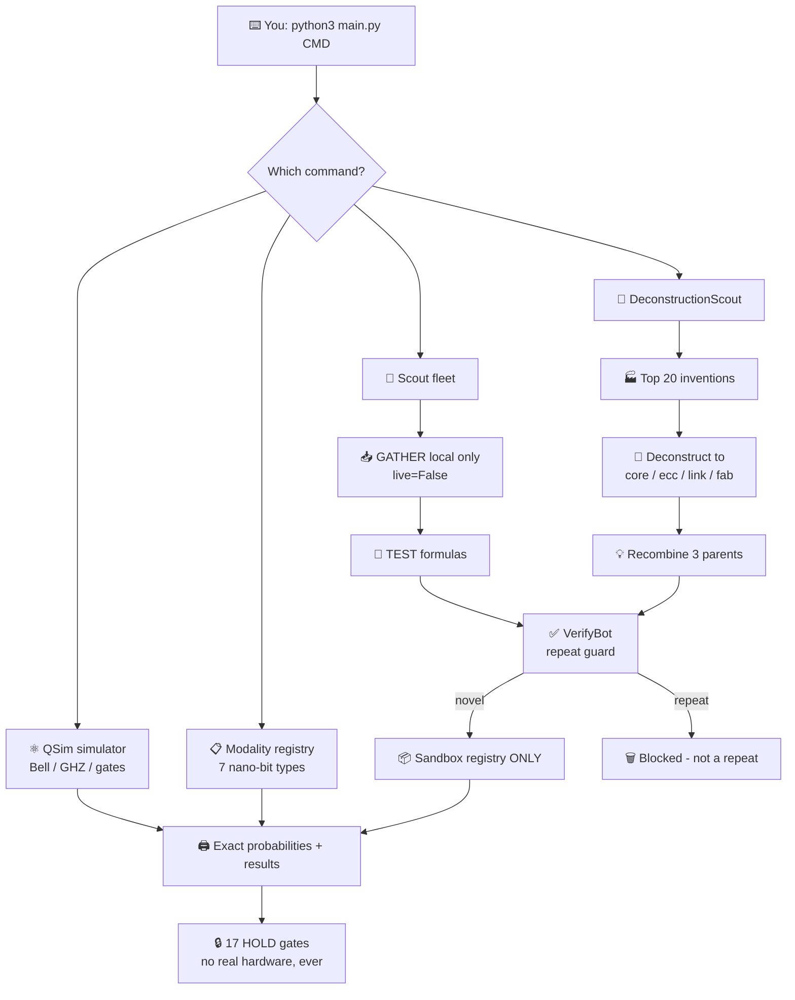
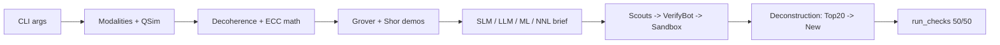
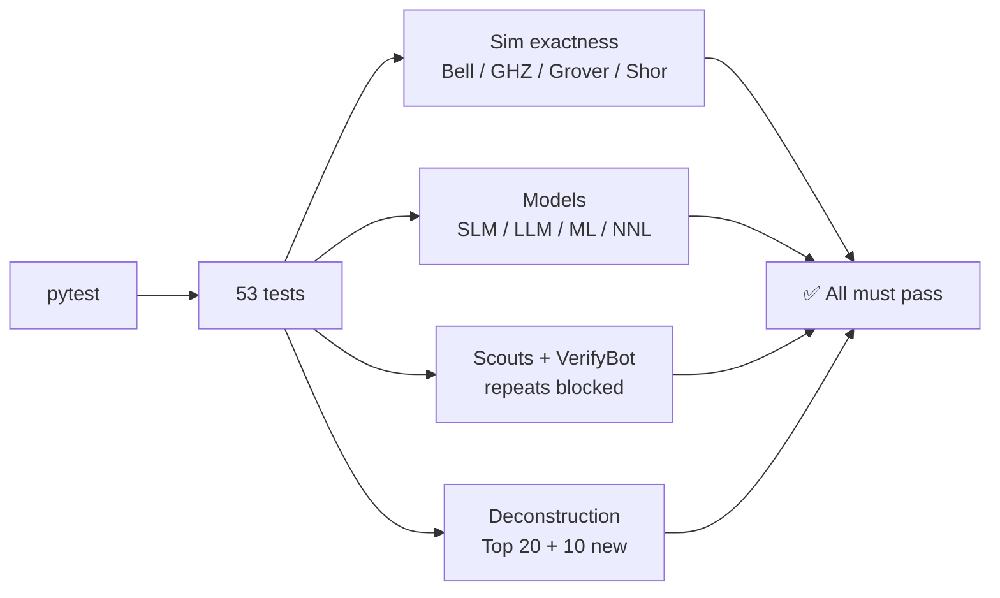
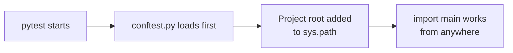
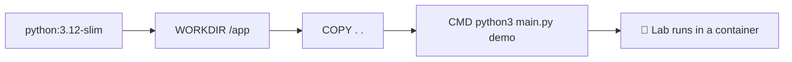

# NanoBits-Q ⚛️🧬


**⚛️ Quantum computing nano-bits technology lab — 7 qubit modalities at nanoscale, a ≤6-qubit statevector simulator, decoherence + error-correction math, Grover & Shor teaching demos, merged SLM / LLM / ML / NNL models, 10 scout bots, a VerifyBot repeat guard, and a DeconstructionScout that breaks down the Top 20 company inventions and creates 10 NEW concept inventions from their parts.**

👨‍💻 Created by Darion Kellar · 📜 MIT License · 🐍 Pure Python standard library, zero dependencies, zero network

> 🔒 Educational local simulation only. No live quantum hardware, no QPU cloud, no chip fabrication — every real-hardware action is a permanent HOLD gate (17 total).

---

## 🛠️ Updated Workflows & Tech Stack Badges

### ⚙️ Workflows (updated)

| Workflow | File | What it does | Status |
|---|---|---|---|
| ✅ CI | `.github/workflows/ci.yml` | Installs pytest, runs the full test suite + `python3 main.py checks` on every push and pull request | 🟡 Paste pending — delivered raw, ready to paste into `.github/workflows/` (plural) |
| 🐳 Docker Publish | `.github/workflows/docker-publish.yml` | Builds the image and publishes `credkellar/nanobits-q:latest` on every push to `main` | 🟡 Paste pending + needs `DOCKERHUB_USERNAME` / `DOCKERHUB_TOKEN` secrets on this repo |

[](https://github.com/kimanicollier44-cmyk/NanoBits-Q/actions/workflows/ci.yml)
[](https://github.com/kimanicollier44-cmyk/NanoBits-Q/actions/workflows/docker-publish.yml)


> 📝 Honest badge note: the live workflow badge SVGs return 404 until the workflow files are pasted and run once, so the two workflow badges above are static shields linked to the real Actions pages. Every badge image in this README was verified live (HTTP 200) before shipping.

### 🧰 Tech Stack Badges


| Category | Stack |
|---|---|
| 💻 Core language | 🐍 Python 3.12, standard library only (`math`, `cmath`, `hashlib`, `json`, `random`, `re`, `argparse`, `dataclasses`) |
| ⚛️ Quantum core | Hand-written statevector simulator (complex amplitudes, H / X / Z / phase / CNOT), Bell + GHZ states, Grover + Shor teaching algorithms |
| 🧬 Nano layer | Modality registry (size nm / temp K / gate ns / coherence µs / fidelity), nano-scale comparator, quantum-dot 1/d² designer, cryo tiers |
| 🧠 Merged models | SLM TinySLM (bigram) · LLM TinyLLM (trigram) · ML kNN classifier · NNL TinyMLP 4-8-1 backprop — all from scratch, advisory only |
| 🐝 Scout fleet | 10 named scout bots + VerifyBot (sha256 fingerprint repeat guard) + DeconstructionScout (Top 20 → components → new inventions) |
| 📊 Data science | Decoherence T2 model, surface-code distance + physical-qubit estimator, fidelity thresholds, paper scoring of concepts |
| 🌐 Web3 & infrastructure | 🚫 None — deliberately offline. No chain, no wallet, no network calls of any kind |
| 🖥️ Platform support | 🐧 Linux · 🍎 macOS · 🪟 Windows — anywhere Python 3.12 runs; 🐳 Docker image included |
| 🔧 DevOps & build tools | GitHub Actions (CI + Docker Publish), Docker, pytest |
| ☁️ Cloud providers | 🚫 None required — offline-first by design. Docker Hub is only an optional publish target |

---

## ❓ What is this about?

🌌 This project is about **quantum computing at the nano scale** — the tiny world where quantum bits (qubits) actually live.

A normal computer bit is a switch: 0 or 1. A **nano-bit** (qubit) is a single electron spin in a 40-nanometre quantum dot, a defect inside a diamond, a photon running through a nano-chip, or an artificial atom on a superconducting chip. At that size — thousands of times smaller than a human hair — the rules of quantum physics take over: a qubit can be 0, 1, and a blend of both at the same time, and qubits can be linked (entangled) so they behave as one system.

🏭 It is also about **who is building this right now**. The second half of the lab is a researched registry of the **Top 20 current company inventions** in nano tech, quantum computing, and data science — Google, IBM, Microsoft, Quantinuum, IonQ, QuEra, and 14 more — broken into parts and recombined into **brand-new concept inventions** by a robot scout, with a second robot checking that nothing new is secretly just a copy of something old.

🎓 And it is honest about what it is: a **teaching lab that runs on your laptop**, not a quantum computer. Every number it produces is labelled simulation, estimate, or company claim — and every step toward real hardware is blocked by a HOLD gate.

---

## 🎯 What this does

1. 📋 **Modality registry** — 7 ways to build a qubit (silicon spin dot 40 nm, superconducting, diamond NV/SnV, photonic, trapped ion, neutral atom, topological), each with size, temperature, gate time, coherence, 2025-26 fidelity, fab method, players, strength, and weakness.
2. 🧮 **Statevector simulator** — run real quantum gates on up to 6 qubits and get exact probabilities. Bell state: `{'00': 0.5, '11': 0.5}`. GHZ state: exact too.
3. 📏 **Nano-scale comparator** — puts sizes in human terms: a 40 nm quantum dot is 2,000× smaller than a human hair and 2,500× smaller than a sheet of paper.
4. 📉 **Decoherence model** — shows fidelity dying with time: `0.5 + (f0 − 0.5)·exp(−t/T2)`. This is the #1 enemy of every quantum computer on Earth.
5. 🛡️ **Error-correction estimator** — surface-code math: 100 logical qubits at 0.1% error need ≈ **105,800 physical qubits**. That ratio is the real price of fault tolerance.
6. 🔍 **Grover teaching demo** — searching 64 items: quantum success **0.9966** vs classical 0.015625. And the honest note: Grover is only a quadratic speedup — it halves effective key bits, it does not break AES-256.
7. 🔓 **Shor teaching demo** — factors 15 = 3×5 and 21 = 3×7 by period-finding, with the threat model stated plainly: Shor threatens RSA/ECC, not AES-256.
8. 🔬 **Quantum-dot designer** — the 1/d² confinement rule: halve the dot, quadruple the energy spacing. 40 nm = single-electron, qubit-grade regime.
9. 🧠 **Merged SLM / LLM / ML / NNL** — four small AI models built from scratch inside the lab (details under *How this works*), fused into one advisory brief per modality. Authority: none. They can never override a HOLD gate.
10. 🐝 **Scout bots gather → test → deploy** — 10 named bots gather local information (zero network), test 8 formulas, and deploy the passes to a **sandbox registry only**.
11. ✅ **VerifyBot checks nothing is a repeat** — re-runs every formula itself, fingerprints it with sha256, and blocks exact, renamed, and look-alike repeats. Cycle 1 deploys 7 formulas; cycle 2 deploys **0** — all 7 blocked as repeats.
12. 🔬 **DeconstructionScout creates new inventions** — deconstructs the Top 20 company inventions into component tags and recombines parts from 3 different parents into **10 NEW concept inventions**, each VerifyBot-checked as novel.

---

## ⚙️ How this works

### The pipeline, end to end

1. **You run one command** — `python3 main.py demo` (or `modalities`, `bell`, `grover`, `scouts`, `invent`, …). One file, one interface.
2. **The simulator** keeps the full quantum state as a list of complex numbers (2ⁿ amplitudes for n qubits) and multiplies it by gate matrices. That is exactly how real quantum software models qubits — just limited to 6 qubits so a laptop never sweats.
3. **The registry** answers hardware questions from measured/reported data: which modality is fastest, coldest, most accurate, most scalable — and where each one fails.
4. **The models** read the same registry: the SLM summarizes it, the LLM drafts from it, the ML classifies each modality, and the NNL scores its scale risk. One fused brief, four viewpoints, zero authority.
5. **The scouts** gather records from the local registry + corpus (`live=False` on every record — they never touch the internet), test formulas against known-correct expected values, and hand the passes to VerifyBot.
6. **VerifyBot** re-runs each formula *itself*, fingerprints the result, and searches the sandbox registry three ways. Only a `novel` verdict deploys — and only into the in-memory sandbox registry. Real deployment does not exist in this code.
7. **DeconstructionScout** takes the Top 20 apart (core / error-correction / link / fab per invention) and builds new concepts from 3 parents at a time — e.g. a superconducting core + Quantinuum's color-code correction + a photonic interconnect. VerifyBot proves each concept is not a repeat of the Top 20 or of its siblings, then it too lands in the sandbox only.
8. **Checks close the loop** — `python3 main.py checks` re-proves the whole system (50/50) and `pytest` proves it again from the outside (53 tests).

### The merged models, honestly labelled

| Model | What it really is | What it does here |
|---|---|---|
| 🗣️ SLM — TinySLM | Bigram extractive summarizer, from scratch | Picks the most on-topic sentence about a modality |
| 💬 LLM — TinyLLM | Trigram drafter, from scratch — **not** a production LLM | Drafts a sentence continuing a prompt, deterministic per seed |
| 📊 ML — MLModalityClassifier | kNN classifier, from scratch | Labels each modality: fault-tolerant candidate / promising / early / unproven |
| 🕸️ NNL — TinyMLP | 4-8-1 backprop neural network, from scratch | Outputs a 0-1 scale-risk score per modality (topological scores highest — correctly) |

### 🧠🎬 Merged brains: Gemini Argon 4 + Google Flow

| Brain | Seat | How it works here |
|---|---|---|
| 🧠 **Gemini Argon 4 Extended Thinking** (Gemini Carbon 4) | **DECIDER** | Engine `gemini-2.5-pro`, model `google/gemini-carbon-4-extended-pro-thinking`. Every decision runs **MAP → MODEL → STRESS → DECIDE** with a sha256 trace hash. Thinking tiers **2048 / 8192 / 32768** by stakes (32768 for deploy decisions). It PROCEEDs clean sandbox evidence and HOLDs anything touching a real-world gate — it can only tighten, **never override a HOLD**. `GEMINI_API_KEY` is names/presence-only; live calls: 0. The scout cycle records both verdicts: sandbox deploy = PROCEED, real deployment = HOLD. Commands: `python3 main.py brains` / `python3 main.py carbon` |
| 🎬 **Google Flow** (all 4 flows) | Planner | **FlowX** — the scout/invent pipeline as a 10-step task graph · **Workspace Studio** — summary/release-note drafts, nothing sent · **Filmmaking** — a 5-shot storyboard (setup → analyze ×2 → verdict → teardown) with Veo-style prompts for a NanoBits-Q explainer, **plan only, never rendered** · **DataX google_flow** — local data-flow plan for Top 20 registry updates. `rendered=False`, `live_calls=0` across all four. Command: `python3 main.py flow` |

---

## 😎 Why is this cool?

Because it takes the hardest technology on Earth — building computers out of single electrons and photons — and makes it something you can **run, test, break, and rebuild on a laptop in one file**, with robots inside it that research the real industry, invent new combinations, and police each other so nothing fake or copied gets through.

### 🔟 10 reasons why this is cool

1. ⚛️ **Real quantum math, not a cartoon** — Bell and GHZ states come out at *exact* probabilities from a real statevector simulator you can read line by line.
2. 🧬 **It thinks in nanometres** — every modality is sized against atoms, DNA, viruses, hair, and paper, so "nano" stops being a buzzword and becomes a number.
3. 🏭 **The Top 20 real inventions are inside it** — Google Willow, IBM Nighthawk, Microsoft Majorana, Quantinuum Helios, and 16 more, deconstructed into parts.
4. 💡 **It invents** — DeconstructionScout doesn't just read the Top 20, it recombines them into 10 new concept machines that exist nowhere else.
5. ✅ **It refuses to repeat itself** — VerifyBot blocks exact copies, renamed copies, and look-alike copies. Run creation twice and the second run deploys *nothing*. That's integrity, automated.
6. 🧠 **Four AIs, zero ego** — SLM, LLM, ML, and NNL are all built from scratch in pure Python, and all four are advisory only. The lab teaches what these models *are*, not just what they output.
7. 📉 **It shows the enemy** — decoherence and the 1,000:1 error-correction tax are computed, not hand-waved. You leave understanding *why* quantum computers are hard.
8. 🔍 **Grover and Shor without the hype** — real speedups, real limits, in numbers: 0.9966 vs 0.015625, and "quadratic only" printed right in the result.
9. 🐍 **Zero dependencies, zero network** — the whole lab is one stdlib Python file. No installs, no API keys, no account, no tracking. It runs in a container, on a plane, forever.
10. 🛡️ **Honesty is a feature with a test suite** — unproven claims are scored lowest (topological: 0.45), planted wrong formulas *fail on purpose*, and 53 tests + 50 checks prove the lab does what this README says.

---

## 🧩 What problems this solves

Quantum computing education and research-tracking have real problems: the field moves weekly, the hype is loud, the math is locked behind paywalls and PhD papers, and "new invention" claims are rarely checked against what already exists. This lab attacks each one with software.

### 🔟 10 solutions

1. **Problem: Quantum hype says "exponential everything."** → ✅ Solution: the lab computes the real numbers — Grover is quadratic (bits halve, they don't vanish) and Shor's threat is scoped to RSA/ECC, printed inside every demo result.
2. **Problem: Nobody can picture a nanometre.** → ✅ Solution: the nano-scale comparator anchors every size to a hair, paper, a virus, DNA, and an atom — 40 nm becomes "2,000× smaller than a hair."
3. **Problem: Seven qubit technologies, no fair scoreboard.** → ✅ Solution: one registry with the same fields for every modality — size, temperature, gate speed, coherence, fidelity, strength, weakness — so comparisons are apples-to-apples.
4. **Problem: Error correction sounds like a footnote, but it's the whole cost.** → ✅ Solution: the surface-code estimator turns "0.1% error" into the real bill — 105,800 physical qubits for 100 logical ones.
5. **Problem: Decoherence is invisible until it kills your computation.** → ✅ Solution: the T2 decay model lets you watch fidelity fall over time for each modality and see *why* coherence time is king.
6. **Problem: Keeping up with 20 companies' inventions is a full-time job.** → ✅ Solution: the Top 20 registry + DeconstructionScout compress the field into components — learn the 20, and you can reason about machines that don't exist yet.
7. **Problem: "New" inventions are often old ones renamed.** → ✅ Solution: VerifyBot's three-way repeat check (exact fingerprint, same name, semantic look-alike) blocks renamed copies automatically — proven by cycle 2 deploying zero.
8. **Problem: AI models in demos are black boxes with hidden authority.** → ✅ Solution: all four models here are tiny, readable, from-scratch, deterministic — and explicitly authority-free, with `can_override_hold: False` enforced in code and tested.
9. **Problem: Quantum demos need cloud accounts, API keys, and queues.** → ✅ Solution: zero network, zero dependencies, zero accounts — the entire lab runs offline from one file, in Docker or bare Python.
10. **Problem: Claims in READMEs (including this one) go untested.** → ✅ Solution: 53 pytest tests + 50 built-in checks re-prove every claim in this document — Bell exactness, Grover's probability, ECC math, repeat-blocking, all of it — on every run.

---

## 📥 How to install this

### Step-by-step

1. **Check you have Python 3.12** 🐍
   ```bash
   python3 --version
   ```
2. **Get the project** 📂 — clone it, or copy the folder:
   ```bash
   git clone https://github.com/kimanicollier44-cmyk/NanoBits-Q.git
   cd NanoBits-Q
   ```
3. **Run the demo** ▶️ — no install step, no dependencies to download:
   ```bash
   python3 main.py demo
   ```
   You should see the Bell state, Grover and Shor results, the scout cycles, and `CHECKS 50/50` at the end.
4. **Try the commands** ⌨️
   ```bash
   python3 main.py modalities                     # the 7 nano-bit modalities
   python3 main.py bell                           # {'00': 0.5, '11': 0.5}
   python3 main.py grover                         # Grover teaching demo
   python3 main.py shor --n 21                    # Shor teaching demo: 21 = 3 x 7
   python3 main.py dot --size 20                  # quantum-dot designer
   python3 main.py ecc                            # surface-code estimate
   python3 main.py brief --modality silicon_spin  # SLM + LLM + ML + NNL brief
   python3 main.py scouts                         # gather -> test -> verify -> sandbox-deploy
   python3 main.py verify                         # VerifyBot repeat-guard demo
   python3 main.py top20                          # Top 20 company inventions
   python3 main.py deconstruct                    # all 20 broken into components
   python3 main.py invent                         # 10 NEW concept inventions
   python3 main.py checks                         # built-in self-checks
   python3 main.py holds                          # all 14 HOLD gates
   ```
5. **Run the tests** 🧪 (the only step that needs a package, and only for testing):
   ```bash
   pip install pytest
   pytest -q
   ```
   Expected: `53 passed`.
6. **Or run it in Docker** 🐳
   ```bash
   docker build -t nanobits-q .
   docker run --rm nanobits-q
   ```
   Or, once published: `docker run --rm credkellar/nanobits-q:latest`

---

## 📋 Requirements

| Requirement | Needed? | Notes |
|---|---|---|
| 🐍 Python 3.12+ | ✅ Yes | The lab itself — standard library only |
| 📦 pip packages | 🚫 No (runtime) | `pytest` only if you want to run the test suite |
| 🌐 Internet | 🚫 No | Zero network by design; scouts read local data only |
| 🔑 API keys / accounts | 🚫 No | No cloud QPU, no AI API, nothing to sign up for |
| 💾 Disk | ~1 MB | One Python file, tests, README, Dockerfile |
| 🧊 A dilution refrigerator | 🤣 No | Temperatures are *modelled* (0.015 K included) — operating one is a HOLD gate |
| ⚛️ A real quantum computer | 🚫 No | Simulated at ≤6 qubits; real hardware is a HOLD gate |

**🔒 HOLD gates (17):** `live_quantum_hardware` · `qpu_cloud_access` · `chip_fabrication` · `cryogenic_operation` · `claim_fault_tolerance` · `claim_quantum_advantage` · `control_real_device` · `sell_hardware` · `scout_live_web` · `deploy_real_hardware` · `deploy_live_formula_to_qpu` · `copy_proprietary_design` · `manufacture_new_invention` · `claim_new_invention_works` · `live_gemini_api_call` · `live_video_generation` · `flow_workspace_send`

---

## 🧒 Explain in 5th grade English

⚛️ **What is this?** A toy quantum computer that lives inside one computer file.

🧊 Imagine a tiny, tiny coin. The coin is so small that 2,000 of them side by side are still thinner than one hair on your head. This tiny coin can land on heads, tails, **or spin in the air and be a little bit of both at the same time**. That spinning coin is called a **qubit**. A normal computer uses plain coins that are always heads or tails. A quantum computer uses spinning coins, and spinning coins can try lots of answers at the same time.

❄️ But there is a catch. If anything bumps the coin — heat, shaking, even a tiny bit of light — it falls down and stops spinning. So real quantum computers must be kept **colder than outer space** and left perfectly alone. Even then, the coins fall a lot, so scientists wrap many coins together to make one strong coin. Sometimes it takes **a thousand little coins to make one good coin**. That is why quantum computers are so hard to build.

🏭 Big companies all over the world are racing to build them: Google, IBM, Microsoft, and many more. Each team builds its coins a different way — out of tiny magnets, trapped atoms, light, or specks of diamond. This project has a **team of little robot helpers** inside it. The robots read about all 20 of the best inventions, take them apart like LEGO bricks, and snap the bricks together in new ways to dream up **10 brand-new machines**. One special robot, **VerifyBot**, checks every new machine and says: "Wait — did we already build this one?" If yes, it goes in the trash, not the trophy shelf. Nothing gets counted twice.

🎓 So this project is a **school lab for the future**: it teaches you how quantum computers work, shows you the best real ones being built today, lets robots invent new ones — and never lies to you about which parts are real and which parts are pretend.

---

## 🧜‍♀️ Mermaid flowchart diagrams

### 🗺️ Master diagram — the whole lab



### 📜 Diagram per script

#### 1. `main.py` — the one interface 🐍



#### 2. `tests/test_main.py` — the outside proof 🧪



#### 3. `conftest.py` — the path fix 🧭



#### 4. `Dockerfile` — the container 🐳



#### 5. `.github/workflows/ci.yml` — continuous integration ✅


#### 6. `.github/workflows/docker-publish.yml` — the publish 🐳🚀


---

## 🌳 Full project structure

```
NanoBits-Q/
├── 📜 main.py                            # ONE interface: simulator, registry, decoherence, ECC, Grover/Shor, dot designer
│                                         # + merged SLM / LLM / ML / NNL + 10 scout bots + VerifyBot + DeconstructionScout (Top 20 -> 10 new)
├── 🧪 tests/
│   └── 📜 test_main.py                   # 53 pytest tests - every claim in this README, re-proven
├── 🧭 conftest.py                        # Root path fix so bare pytest works
├── 📄 README.md                          # This file
├── 🐳 Dockerfile                         # python:3.12-slim, CMD = demo
└── ⚙️ .github/workflows/
    ├── ✅ ci.yml                         # pytest + checks on push / PR (paste pending)
    └── 🐳 docker-publish.yml             # -> credkellar/nanobits-q:latest (paste + secrets pending)
```

---

## 📚 Sources for the Top 20

Researched live on 2026-11-14: *Quantum Computing in 2025–2026* (permutations.app); *Quantum Industry Map* (amotoolkit.com); *Frontier Milestones* quantum tracker; imec High-NA EUV quantum-dot fabrication (embedded.com, May 2026); Tanaka / Nagoya University lead-free Ag-S-Te quantum dots (Oct 2026). Company qubit and fidelity numbers are the companies' **reported** figures. Microsoft's topological claims remain **disputed** in the literature and are scored lowest in the registry (0.45–0.50) for exactly that reason. The 10 new inventions are original *concept recombinations* of public component ideas — data-only specs, not built, not patented, not claimed to work.

## 📜 License

MIT © 2026 Darion Kellar
